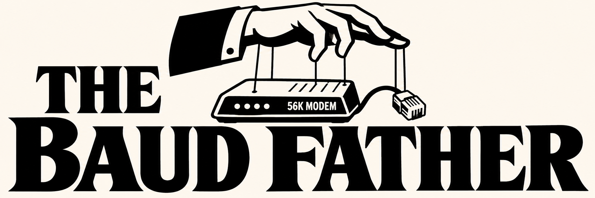

<p align="center"></p>

# The Baud Father

I miss the sounds of the 90s: the click of the line, the dial tone, a burst of fast DTMF digits, and then two
modems screaming at each other until they agree on a speed. Nothing I own makes that noise any more.

So here is the solution. Two real US Robotics Courier V.Everything modems sit on my desk, wired back to back 
on a private line that goes nowhere. When my phone rings, a message arrives, mail comes in or someone presses 
the button, an ESP32 makes one modem call the other. The handshake, from a real modem speaker, is the notification.

**Never connected to a real phone line.** The two modems only ever talk to each other.

## What it sounds like

| When | What you hear |
|---|---|
| The RING button | Dial tone, dialling, ringback, and a real V.34 handshake: `CONNECT 33600` |
| A phone call | A handshake that struggles for 20 seconds and fails, a redial, and then a connect |
| A WhatsApp or Signal call | A clean 33.6k connect |
| A WhatsApp or Signal message | The line lifts and a robot voice says "WhatsApp message" or "Signal message" |
| New mail in Thunderbird | "Incoming e-mail" |
| The Demo button in the app | A full call, then both voices |

The failed negotiation is real, too. The ESP32 plays a 1750 Hz tone onto the line, right on the frequencies
the modems use to introduce themselves, so they keep trying and never agree. When the tone stops, they connect.

## How it works

- An **ESP32** (original WROOM-32, for Bluetooth LE plus the DAC) drives both modems over RS232 through two
  MAX3232 boards. It sends `ATDT…` to one and `ATA` to the other, and hangs up by dropping DTR.
- The ESP32's **DAC** makes the 425 Hz dial tone, the ringback, the voice clips and the jamming tone. A Bourns
  SM-LP-5001 600:600 transformer couples them onto the line.
- The **line** is the two modems in series with a 12 V feed through 150 Ω. My answering modem is a European
  model that refuses a line with no voltage and hangs up on one with too little current.
- An **Android app** watches for calls and notifications and tells the box which ringtone to play, over a
  bonded Bluetooth LE link. It reads the notifying app's name and nothing else.
- A small **script on my Linux laptop** does the same for Thunderbird's new-mail notifications.
- The **voices** come from the espeak-ng formant synthesizer, flattened and crushed to 8 bits so they sound
  like an Amiga reading the news.

Up to three devices can be connected at once. Pairing only works during a 60-second window that you open by
holding the button on the box for three seconds.

## What is in here

| Path | What |
|---|---|
| `firmware/` | ESP-IDF 5.5 project in C: the call sequence, ringtones, audio engine, Bluetooth, and an AT console over USB. Pins, timings and the ringtone table are in `main/config.h`. |
| `app/` | The Android app in plain Java, built with the SDK build-tools only (no Gradle, no dependencies). |
| `tools/` | Python helpers, standard library only: serial log capture, the AT console, the sound-bank builder, the voice generator, the mail watcher. |
| `notes/` | Wiring, the schematic, the case, the Bluetooth protocol, and what the modems said about themselves. |
| `cad/` | The 3D-printed case (FreeCAD). |

Start with [`notes/wiring.md`](notes/wiring.md) for the hardware and [`notes/ble.md`](notes/ble.md) for the
protocol.

## Build

Firmware (ESP-IDF v5.5):
```sh
. $IDF_PATH/export.sh
python3 tools/mkspeech.py        # the voice clips (needs libespeak-ng on the system)
python3 tools/mksounds.py        # pack the clips into the sound bank
cd firmware && idf.py build && idf.py -p /dev/ttyUSB0 flash
```
The number the box dials is `0123456789` unless you put your own in `firmware/main/config_local.h`
(see `config.h`). It is only ever dialled on the closed line.

Android app (Android SDK with build-tools 36.1 and platform 36, JDK 17+):
```sh
app/build.sh
adb install -r app/build/doorbell.apk
```

Mail watcher (Linux, BlueZ): pair the laptop with the box, then run `python3 tools/mailbell.py`, or install
`tools/mailbell.service` as a systemd user unit.

## Things I learned the hard way

- **Give the line some current.** Old modems will handshake on a dead wire. A European (CTR21) one wants loop
  voltage and around 20 mA before it believes there is a line.
- **The serial speed caps the link speed.** At 9600 baud to the modems, they connected at 9600. At 115200 they
  connect at 33.6k. Back to back you never get 56k: that needs a digital line on one side.
- **A modem that says nothing may be waiting for RTS.** One of mine came with `&R2` stored and stayed silent
  until I found it with a USB serial adapter.
- **An ESP32 DevKit can brown out when Bluetooth starts.** Put 100–470 µF between 3V3 and GND.
- **Some DevKits label the flash pins "D0–D3".** Don't connect anything there.

## Licence

MIT, see [`LICENSE`](LICENSE). The modems, their names and their noises belong to their makers and to the
1990s.
